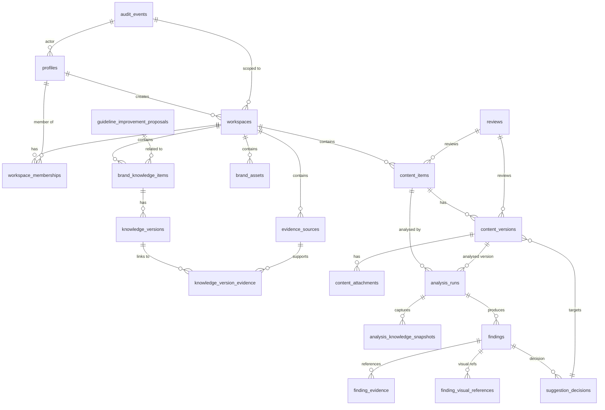

# BrandProof AI Database

## Overview
This directory contains the **Supabase‑compatible PostgreSQL schema** for the BrandProof AI platform.  The schema is designed for a multi‑tenant architecture where every record is scoped to a `workspace_id`.  All primary keys are UUIDs generated by `gen_random_uuid()`.  The tables capture user profiles, workspaces, knowledge items with versioning, evidence sources, brand assets, marketing content with versioning, analysis runs, findings, suggestion decisions, reviews, audit events, and guideline‑improvement proposals.

The schema deliberately **does not enable Row‑Level Security (RLS)** – this can be added later when the deployment environment is ready.  No binary data is stored; file metadata points to objects that will live in Supabase Storage buckets.

---

## Folder Structure
```
brandproof-ai/
├─ supabase/
│   ├─ config.toml                # Supabase CLI placeholder configuration
│   ├─ migrations/
│   │   ├─ 001_initial_schema.sql          # All tables, enums, constraints
│   │   ├─ 002_indexes_and_constraints.sql # Performance‑focused indexes
│   │   └─ 003_storage_metadata.sql        # Documentation of bucket conventions
│   └─ seed.sql                    # Optional synthetic demo data (clearly labelled)
├─ database/
│   └─ README.md                  # **You are reading this file**
└─ (existing project files…)      # Your frontend / backend code lives elsewhere
```

---

## Key Concepts
* **Workspace isolation** – every table (except `profiles`) includes a `workspace_id` column with a foreign key to `workspaces(id)`.  Composite unique constraints and foreign‑key checks prevent cross‑workspace references.
* **Versioning** – `brand_knowledge_items` → `knowledge_versions` and `content_items` → `content_versions` store immutable history.  The parent row keeps a `current_version_id` that can be updated by the application.
* **File metadata** – tables such as `brand_assets` and `content_attachments` store `storage_bucket` and `storage_path`.  Actual binaries live in Supabase Storage buckets (private by default).
* **Enums & constraints** – all status, role, type, and outcome values are expressed as PostgreSQL `ENUM`s with appropriate `CHECK` constraints.
* **Audit trail** – `audit_events` is append‑only; no UPDATE/DELETE privileges are granted to ordinary users.
* **No RLS** – the schema does **not** contain `ENABLE ROW LEVEL SECURITY` or `CREATE POLICY` statements, per the requirement.

---

## How to Apply Locally
1. Install PostgreSQL (>= 13) and the `pgcrypto` extension (the migrations create it if missing).
2. `cd` to the repository root.
3. Run the Supabase CLI (or plain `psql`) to apply migrations in order:
   ```bash
   # Using the Supabase CLI (recommended)
   supabase start          # starts a local Postgres instance
   supabase db push       # applies the migrations under supabase/migrations
   ```
   Or with `psql`:
   ```bash
   psql -U <user> -d <db_name> -f supabase/migrations/001_initial_schema.sql
   psql -U <user> -d <db_name> -f supabase/migrations/002_indexes_and_constraints.sql
   psql -U <user> -d <db_name> -f supabase/migrations/003_storage_metadata.sql
   ```
4. (Optional) Load the demo data:
   ```bash
   psql -U <user> -d <db_name> -f supabase/seed.sql
   ```
   The seed inserts a single demo workspace, user profile, knowledge item, content, analysis run, finding, etc.  All rows are clearly marked as synthetic.
5. Verify the schema:
   ```sql
   SELECT table_name FROM information_schema.tables WHERE table_schema = 'public';
   ```

---

## Important Notes Before Deployment
* **RLS** – Add `ENABLE ROW LEVEL SECURITY` and appropriate `CREATE POLICY` statements once you move to a hosted Supabase instance.
* **Supabase Auth** – The `profiles.id` column is expected to reference `auth.users(id)` in production.  For local testing you can populate `profiles` directly.
* **Storage Buckets** – Create the buckets defined in `003_storage_metadata.sql` via the Supabase dashboard or CLI (`supabase storage bucket create`).  The application will write objects using the path conventions documented there.
* **Environment variables** – Use a `.env` file locally with `MONGODB_URL` (for the earlier MongoDB prototype) **or** `DATABASE_URL` for PostgreSQL.  The placeholder `.env.example` already contains a `MONGODB_URL`; replace it with a PostgreSQL connection string when you switch to this schema.
* **Permissions** – In production, grant the API role `INSERT`, `SELECT`, `UPDATE` (where appropriate) on these tables, but restrict `DELETE` to admin users only.

---

## ER Diagram (Mermaid)


---

## Next Steps
* Wire the backend (FastAPI, Node, etc.) to use these tables.
* Implement RLS policies and Supabase Storage bucket creation.
* Add unit tests that spin up a temporary PostgreSQL instance and run the migrations.
* Extend the schema with any additional MVP features (e.g., campaigns) when needed.

---

*All files created for this task are listed below.*
